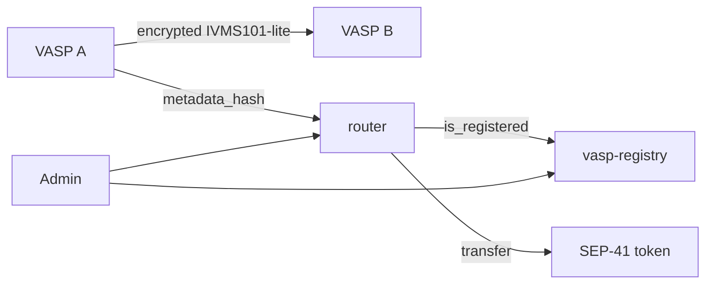
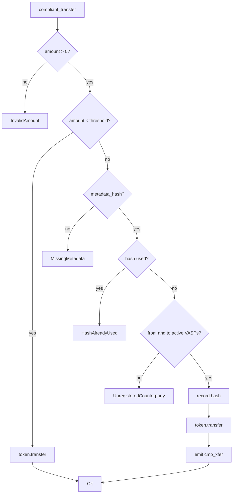

# Build Specification

This document is the technical contract for the Corridor system. It describes
the on-chain interfaces, storage layout, error codes, security properties, and
the acceptance criteria a change must meet. It is intentionally concrete: if the
code and this document disagree, that is a bug.

- **Status:** reference implementation, testnet-ready, not audited.
- **Target network:** Stellar / Soroban.
- **Rust crate root:** [`Cargo.toml`](./Cargo.toml).
- **Architecture narrative:** [`docs/architecture.md`](./docs/architecture.md).
- **Deployment guide:** [`docs/DEPLOYMENT.md`](./docs/DEPLOYMENT.md).

## 1. Purpose

Stellar's [SEP-41](./README.md#references) token interface exposes
`transfer(from, to, amount)` with no field for compliance metadata. Corridor
adds a *policy layer* in front of a SEP-41 token:

- Transfers below a configurable threshold behave like a normal token transfer.
- Transfers at or above the threshold must carry a `metadata_hash`: a SHA-256
  commitment to a Travel-Rule payload exchanged off-chain.
- Both counterparties must be registered, active VASPs.
- A commitment can be consumed once, preventing replay.

Personal data never reaches the ledger. Only hashes, addresses, and endpoint
URLs are stored.

## 2. Non-goals (v1)

- Full [IVMS101](https://intervasp.org/) support. v1 uses IVMS101-*lite*.
- On-chain identity attestation or VASP accreditation.
- Storing or transmitting the compliance payload on-chain.
- A production key-management system. The off-chain service encrypts with a
  clearly-marked stub and must be replaced before real use.
- Multisig / governance administration. The registry uses a single admin in v1;
  the admin can be a multisig account.
- Token upgrades. Contracts are immutable; a new policy version is deployed as
  a new contract and the old one is drained/retired.

## 3. Actors

| Actor | Description |
|---|---|
| Admin | Controls the registry allowlist and the router threshold. |
| VASP | A registered, active address allowed to move value at/above the threshold. |
| Sender | The address authorizing `compliant_transfer`; must be an active VASP above threshold. |
| Recipient | The destination address; must be an active VASP above threshold. |
| Off-chain service | Exchanges encrypted payloads between VASPs and computes the commitment. |

## 4. System overview



## 5. Contract: `vasp-registry`

Source: [`contracts/vasp-registry/src/lib.rs`](./contracts/vasp-registry/src/lib.rs).

### 5.1 Storage

| Key | Storage | Value | Notes |
|---|---|---|---|
| `DataKey::Admin` | instance | `Address` | Set once in `initialize`. |
| `DataKey::Vasp(Address)` | persistent | `VaspInfo` | One entry per VASP; soft-deleted via `active = false`. |

`VaspInfo` (from [`contracts/common`](./contracts/common/src/lib.rs)):

```rust
pub struct VaspInfo {
    pub address: Address,
    pub endpoint_url: String,
    pub active: bool,
}
```

### 5.2 Interface

| Function | Auth | Returns | Notes |
|---|---|---|---|
| `initialize(admin)` | `admin` | `()` | Panics if already initialized. See §10 for the first-caller caveat. |
| `add_vasp(caller, vasp, endpoint_url)` | `caller` (must be admin) | `Result<(), RegistryError>` | Creates or reactivates an entry. |
| `remove_vasp(caller, vasp)` | `caller` (must be admin) | `Result<(), RegistryError>` | Soft delete; `NotFound` if absent. |
| `is_registered(vasp)` | none | `bool` | True only when the entry exists and is active. |
| `get_endpoint(vasp)` | none | `Option<String>` | `None` for unknown or inactive. |
| `get_admin()` | none | `Address` | |
| `transfer_admin(caller, new_admin)` | `caller` (must be admin) | `Result<(), RegistryError>` | |

### 5.3 Errors

| Code | Variant | Meaning |
|---|---|---|
| 1 | `Unauthorized` | Caller is not the admin. |
| 2 | `NotFound` | No entry exists for the supplied address. |
| 3 | `AlreadyInitialized` | Reserved for compatibility; `initialize` currently panics. |

### 5.4 Events

| Topic | Data | Emitted by |
|---|---|---|
| `vasp_add` + `vasp` | `()` | `add_vasp` |
| `vasp_rem` + `vasp` | `()` | `remove_vasp` |
| `admin_xfr` | `(old_admin, new_admin)` | `transfer_admin` |

### 5.5 Invariants

1. Only one admin exists at a time.
2. A removed VASP keeps its record (audit trail) but reports `active = false`.
3. Re-adding a removed VASP replaces the endpoint and sets `active = true`.
4. `is_registered` is the single source of truth used by the router.

## 6. Contract: `router`

Source: [`contracts/router/src/lib.rs`](./contracts/router/src/lib.rs).

### 6.1 Storage

| Key | Storage | Value | Notes |
|---|---|---|---|
| `DataKey::Admin` | instance | `Address` | |
| `DataKey::TokenAddress` | instance | `Address` | Wrapped SEP-41 token. |
| `DataKey::RegistryAddress` | instance | `Address` | VASP registry contract. |
| `DataKey::Threshold` | instance | `i128` | `>= 0`. |
| `DataKey::UsedHash(BytesN<32>)` | persistent | `bool` | Replay-protection marker. |

### 6.2 Interface

| Function | Auth | Returns | Notes |
|---|---|---|---|
| `initialize(admin, token, registry, threshold)` | `admin` | `()` | Panics if initialized or `threshold < 0`. See §10. |
| `compliant_transfer(from, to, amount, metadata_hash)` | `from` | `Result<(), RouterError>` | See state machine below. |
| `set_threshold(caller, new_threshold)` | `caller` (must be admin) | `Result<(), RouterError>` | Rejects negative values. |
| `get_threshold()` | none | `i128` | |
| `get_admin()` | none | `Address` | |
| `get_token()` | none | `Address` | |
| `get_registry()` | none | `Address` | |
| `is_hash_used(hash)` | none | `bool` | |

### 6.3 Transfer state machine



The hash is recorded **before** the token transfer (checks-effects-interactions)
so a re-entrant or malicious token cannot consume the same commitment twice.

### 6.4 Errors

| Code | Variant | Meaning |
|---|---|---|
| 1 | `MissingMetadata` | Transfer at/above threshold without a hash. |
| 2 | `HashAlreadyUsed` | Commitment has already been consumed. |
| 3 | `UnregisteredCounterparty` | Either party is not an active VASP. |
| 4 | `Unauthorized` | Caller is not the admin. |
| 5 | `InvalidAmount` | Amount is zero or negative. |
| 6 | `InvalidThreshold` | Threshold is negative. |

These numeric values are part of the public ABI and are covered by
`RouterError` stability tests.

### 6.5 Events

| Topic | Data | Emitted by |
|---|---|---|
| `xfer` + `from` + `to` | `amount` | Below-threshold pass-through |
| `cmp_xfer` + `from` + `to` | `(amount, hash)` | Compliant transfer |

### 6.6 Threshold semantics

- `amount < threshold` → pass-through.
- `amount >= threshold` → compliance required.
- `threshold = 0` → every positive transfer requires compliance.
- A threshold change applies to subsequent calls only; there is no retroactive
  effect.

## 7. Storage lifetime (TTL)

Soroban entries expire unless their TTL is extended. Corridor uses the
constants in [`contracts/common/src/lib.rs`](./contracts/common/src/lib.rs):

| Constant | Value | Meaning |
|---|---|---|
| `DAY_IN_LEDGERS` | `17_280` | ≈1 day at 5s ledgers. |
| `INSTANCE_BUMP_THRESHOLD` | 30 days | Bump instance storage below this. |
| `INSTANCE_BUMP_AMOUNT` | 60 days | Target instance lifetime. |
| `PERSISTENT_BUMP_THRESHOLD` | 30 days | Bump persistent entries below this. |
| `PERSISTENT_BUMP_AMOUNT` | 90 days | Target persistent lifetime. |

Every state-changing entry point and every live read (`is_registered`,
`get_endpoint`, router getters) refreshes the relevant TTL. Without this, a
lapsed `UsedHash` entry could be replayed and a lapsed VASP entry could silently
de-list a counterparty.

> **Operational note:** an entry that is never read or written can still expire.
> Operators should keep a monitoring job that periodically calls the read
> endpoints, or run a small "heartbeat" transaction.

## 8. Off-chain metadata exchange

Source: [`offchain/metadata-exchange`](./offchain/metadata-exchange).

### 8.1 Payload (IVMS101-lite)

```ts
interface TravelRulePayload {
  originator: { name: string; vasp_id: string; account_ref: string };
  beneficiary: { name: string; vasp_id: string; account_ref: string };
  amount: string;      // decimal string
  asset_code: string;  // e.g. "USDC"
  timestamp: string;   // ISO-8601
}
```

### 8.2 Canonicalization and commitment

1. Recursively sort object keys.
2. Remove all insignificant whitespace.
3. SHA-256 the UTF-8 bytes.
4. Hex-encode the 32-byte digest.

The TypeScript SDK and the off-chain service implement the same algorithm and
are covered by regression tests that assert order independence and a fixed
canonical digest.

### 8.3 Endpoints

| Method | Path | Purpose |
|---|---|---|
| `POST` | `/v1/travel-rule/initiate` | Hash + encrypt a payload and (in production) deliver it. |
| `POST` | `/v1/travel-rule/receive` | Decrypt, verify, and store an inbound payload. |
| `GET` | `/v1/travel-rule/verify/:hash` | Confirm a counterparty holds a payload. |
| `GET` | `/health` | Liveness probe. |

The reference service uses in-memory storage and a symmetric-encryption stub.
Both are explicitly non-production and must be replaced with a database,
KMS/HSM-backed keys, signed requests, and mutual TLS.

## 9. TypeScript SDK

Source: [`sdk/ts`](./sdk/ts).

| Export | Purpose |
|---|---|
| `hashPayload(payload)` | Canonical SHA-256 commitment. |
| `hexToBuffer(hash)` | Validated 32-byte conversion. |
| `buildCompliantTransferTx(params)` | Build and simulate a `compliant_transfer` transaction. |
| `verifyVaspRegistered(registryId, vasp, rpcUrl)` | Read-only registry check. |

`Option<T>` is encoded the Soroban way: `ScVal::Void` for `None`, the inner
value for `Some`. Do not wrap it in a synthetic tagged union.

## 10. Security model

| Threat | Mitigation |
|---|---|
| Replay of a compliance commitment | `UsedHash` marker, written before value moves. |
| Unauthorized initialization | `initialize` requires the admin's authorization. |
| First-caller initialization race | Deploy and initialize atomically; verify `get_admin()` immediately. |
| Unauthorized registry changes | Caller must authenticate *and* equal the stored admin. |
| De-listing a VASP by TTL lapse | TTL refresh on every registry interaction. |
| PII on the public ledger | Only hashes, addresses, and endpoint URLs are stored. |
| Re-entrant token consuming a hash twice | Effects before interaction. |
| Zero/negative transfer amounts | Rejected with `InvalidAmount`. |
| Stale threshold | Admin-only update, events emitted by the registry for audit. |

Known limitations are listed in [`SECURITY.md`](./SECURITY.md).

## 11. Testing requirements

Every PR must keep the following green:

```bash
cargo fmt --all -- --check
cargo clippy --workspace --all-targets -- -D warnings
cargo test --workspace
cargo build --workspace --target wasm32-unknown-unknown --release
(cd sdk/ts && npm ci && npm run build && npm test)
(cd offchain/metadata-exchange && npm ci && npm run build && npm test)
```

Contract tests use `soroban-sdk`'s `testutils` host and cover:

- initialization and double-initialization,
- authorization for every admin function,
- below/at/above-threshold routing,
- replay protection,
- registered vs. unregistered vs. removed counterparties,
- non-positive amounts and negative thresholds,
- TTL-observable storage behaviour.

## 12. Compatibility and change policy

- Contract entry points are immutable once deployed.
- Adding an error variant or event is backwards compatible; changing an existing
  numeric code is **breaking**.
- Storage-key or value-shape changes require a migration plan and a new contract
  version.
- Update [`CHANGELOG.md`](./CHANGELOG.md) for every ABI or behaviour change.
