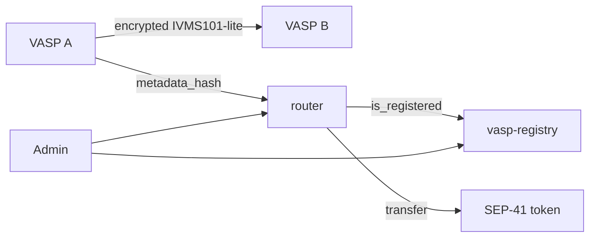

# Corridor

[](https://github.com/Corridorh/corridor/actions/workflows/ci.yml)
[](./LICENSE)

**Travel-Rule compliant payment routing on Stellar.**

Corridor is a [Soroban](https://developers.stellar.org/docs/build/smart-contracts)
contract system that wraps any [SEP-41](https://github.com/stellar/stellar-protocol/blob/master/ecosystem/sep-0041.md)
token with threshold-gated [FATF Travel Rule](https://www.fatf-gafi.org/)
checks. Compliance metadata is committed on-chain as a hash and exchanged
off-chain, so **no personal data ever reaches the ledger**.

## Why

SEP-41 defines `transfer(from, to, amount)` with no field for originator or
beneficiary information. Regulated VASPs therefore either enforce the Travel
Rule entirely off-chain — with no on-chain evidence — or not at all.

Corridor adds a policy layer:

- Below a configurable threshold, transfers pass through like a normal token.
- At or above the threshold, the transfer must carry a `metadata_hash`: a
  SHA-256 commitment to a payload exchanged off-chain.
- Both counterparties must be registered, active VASPs.
- A commitment can be used once, preventing replay.



See [`docs/architecture.md`](./docs/architecture.md) for the full design and
[`BUILD-SPEC.md`](./BUILD-SPEC.md) for the exact interfaces and storage layout.

## Repository layout

| Path | What it is |
|---|---|
| [`contracts/router`](./contracts/router/src/lib.rs) | Soroban contract that enforces the threshold, replay protection, and allowlist before moving tokens. |
| [`contracts/vasp-registry`](./contracts/vasp-registry/src/lib.rs) | Soroban contract maintaining the VASP allowlist and endpoint directory. |
| [`contracts/common`](./contracts/common/src/lib.rs) | Shared types, ABI-stable error codes, and TTL constants. |
| [`offchain/metadata-exchange`](./offchain/metadata-exchange) | Reference Node/TypeScript service for encrypted payload exchange and hashing. |
| [`sdk/ts`](./sdk/ts) | TypeScript SDK for building, simulating, and verifying `compliant_transfer` calls. |
| [`tests/integration`](./tests/integration/README.md) | Cross-contract test strategy and Testnet smoke checklist. |
| [`deployments`](./deployments/README.md) | Machine-readable deployment records. |
| [`docs`](./docs/architecture.md) | Architecture, deployment, and scoped roadmap. |

## Quick start

### Prerequisites

- Rust stable with the `wasm32-unknown-unknown` target (the repo pins this in
  [`rust-toolchain.toml`](./rust-toolchain.toml))
- Node.js 20+
- The [Stellar CLI](https://developers.stellar.org/docs/tools/cli/install-cli),
  only for deploying

### Build and test the contracts

```bash
git clone https://github.com/Corridorh/corridor.git
cd corridor
rustup target add wasm32-unknown-unknown

cargo test --workspace
cargo build --workspace --target wasm32-unknown-unknown --release
```

Artifacts:

```
target/wasm32-unknown-unknown/release/router.wasm
target/wasm32-unknown-unknown/release/vasp_registry.wasm
```

### Use the SDK

```bash
cd sdk/ts
npm install
npm run build
npm test
```

```ts
import { hashPayload, buildCompliantTransferTx } from "soroban-travel-rule-sdk";

const metadataHash = hashPayload({
  originator: { name: "Alice", vasp_id: "VASP-A", account_ref: "acct-1" },
  beneficiary: { name: "Bob", vasp_id: "VASP-B", account_ref: "acct-2" },
  amount: "5000",
  asset_code: "USDC",
  timestamp: new Date().toISOString(),
});

const xdr = await buildCompliantTransferTx({
  routerContractId: "C...",
  from: "G...",
  to: "G...",
  amount: "5000",
  metadataHash,
  networkPassphrase: "Test SDF Network ; September 2015",
  rpcUrl: "https://soroban-testnet.stellar.org",
});
```

### Run the off-chain reference service

```bash
cd offchain/metadata-exchange
npm install
npm run build
npm test
npm run dev
```

The service is a **reference implementation**: encryption is a clearly-marked
stub and storage is in-memory. See [`SECURITY.md`](./SECURITY.md) before using
it anywhere real.

### Deploy to Testnet

Follow [`docs/DEPLOYMENT.md`](./docs/DEPLOYMENT.md). It includes the exact
`stellar contract deploy` / `invoke` commands, initialization order, and a
post-deployment checklist.

## Security properties

| Property | How it is enforced |
|---|---|
| No PII on-chain | Only hashes, addresses, and endpoint URLs are stored. |
| Replay protection | A commitment is recorded before value moves and cannot be reused. |
| Front-running resistance | `initialize` requires the admin's authorization. |
| Allowlist integrity | Only the admin can add, remove, or transfer admin rights. |
| Storage lifetime | Instance and persistent TTLs are refreshed on every live access. |
| Re-entrancy safety | Effects are written before the external token call. |
| Input validation | Zero/negative amounts and negative thresholds are rejected. |

Known limitations and the disclosure process are documented in
[`SECURITY.md`](./SECURITY.md).

## Status

Corridor is a **reference implementation**, testnet-ready but **not audited**.
Contracts are immutable and expose no upgrade entry point. The off-chain
service must replace its encryption/storage stubs before production use.
See [`docs/ROADMAP.md`](./docs/ROADMAP.md) for the work required to reach a
production deployment.

## Documentation

- [Build specification](./BUILD-SPEC.md) — interfaces, storage, errors, events,
  TTL policy, security model.
- [Architecture](./docs/architecture.md) — design rationale, sequence diagrams,
  failure modes.
- [Deployment](./docs/DEPLOYMENT.md) — build, deploy, initialize, verify.
- [Roadmap](./docs/ROADMAP.md) — pre-scoped work with acceptance criteria.
- [Contributing](./CONTRIBUTING.md) — setup, checks, commit and PR conventions.
- [Security policy](./SECURITY.md) — reporting and known limitations.
- [Changelog](./CHANGELOG.md).

## Drips Stellar Wave

Contributions are welcome through the
[Drips Stellar Wave](https://docs.drips.network/wave/) program.

Issues labelled `Stellar Wave` are eligible for the current sprint. Each issue
includes acceptance criteria; comment on the issue to apply and a maintainer
will assign you. Pre-scoped tasks — sized **Trivial / Medium / High** — are
listed in [`docs/ROADMAP.md`](./docs/ROADMAP.md).

Please read [`CONTRIBUTING.md`](./CONTRIBUTING.md) before opening a pull
request. Security issues must be reported privately per
[`SECURITY.md`](./SECURITY.md).

## License

[MIT](./LICENSE).

## References

- [SEP-41: Soroban Token Interface](https://github.com/stellar/stellar-protocol/blob/master/ecosystem/sep-0041.md)
- [Soroban documentation](https://developers.stellar.org/docs/build/smart-contracts)
- [FATF Recommendation 16](https://www.fatf-gafi.org/)
- [TRISA](https://trisa.io/) — reference for the on-chain/off-chain pattern
- [IVMS101](https://intervasp.org/)
