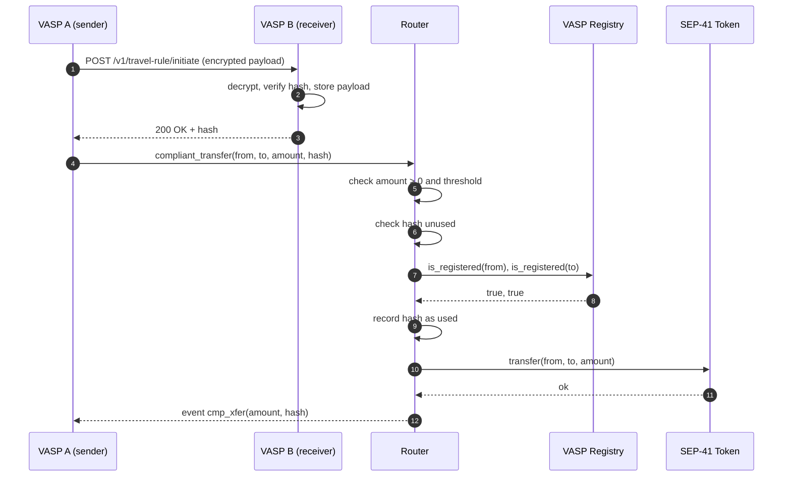

# Architecture

This document explains *why* Corridor is built the way it is. For the exact
interfaces and error codes, see [`BUILD-SPEC.md`](../BUILD-SPEC.md).

## 1. The problem

FATF Recommendation 16 (the "Travel Rule") requires regulated virtual-asset
service providers to exchange originator and beneficiary information for
qualifying transfers. Stellar's SEP-41 token interface is deliberately minimal:

```rust
fn transfer(env: Env, from: Address, to: Address, amount: i128);
```

There is no field for compliance data, and putting personal data on a public
ledger would be unacceptable. As a result, VASPs on Stellar either enforce the
Travel Rule entirely off-chain — with no on-chain evidence that the exchange
happened — or do not enforce it at all.

## 2. Design principle: commit, don't publish

Corridor separates *what happened* from *the evidence that it happened*:

- The payload (names, account references, VASP identifiers) stays off-chain.
- The ledger stores a 32-byte SHA-256 commitment and the addresses involved.
- Anyone can later prove that a given payload matches a commitment by
  re-hashing it, without the payload ever being published.
- A commitment is single-use, so it cannot be replayed for a second transfer.

This is the same pattern used by TRISA, TRP, and Sygna. It gives regulators an
auditable on-chain trail while keeping PII off-chain.

## 3. Components

```
┌─────────────────────────────────────────────────────────────────────┐
│                           Off-chain                                 │
│                                                                     │
│   VASP A service ── encrypted IVMS101-lite ──▶ VASP B service       │
│          │                                            │             │
│          └────────── metadata_hash ──────────┐        │             │
└──────────────────────────────────────────────┼────────┼─────────────┘
                                               │        │
┌──────────────────────────────────────────────┼────────┼─────────────┐
│                           On-chain           ▼        │             │
│                                                                     │
│   ┌──────────────────┐    is_registered   ┌──────────────────┐      │
│   │      router      │ ─────────────────▶ │  vasp-registry   │      │
│   │ compliant_transfer│                    │  add/remove VASP │      │
│   └────────┬─────────┘                    └──────────────────┘      │
│            │ transfer                                               │
│            ▼                                                        │
│   ┌──────────────────┐                                              │
│   │   SEP-41 token   │  (SAC, USDC, ...)                            │
│   └──────────────────┘                                              │
└─────────────────────────────────────────────────────────────────────┘
```

| Component | Responsibility | Trust boundary |
|---|---|---|
| `router` | Enforces threshold, replay, and counterparty policy; moves tokens. | Trusts the configured token and registry addresses. |
| `vasp-registry` | Maintains the allowlist and endpoint directory. | Trusts the admin. |
| Off-chain service | Exchanges encrypted payloads, computes commitments. | Trusts its own key material and its counterparty's TLS endpoint. |
| SDK | Builds and simulates transactions. | Trusts the RPC response it verifies. |

## 4. End-to-end flow



Steps 1–3 are off-chain and not enforced by the contract. The contract enforces
that *some* commitment was supplied and that both parties are allowlisted; a
counterparty could still fail to actually deliver the payload. Production
deployments close that gap by making the `verify` check a precondition in the
VASP's own workflow (and, eventually, by adding signed delivery receipts).

## 5. Why a wrapper contract instead of a token extension?

- SEP-41 tokens (including the Stellar Asset Contract) are already deployed and
  cannot be modified.
- A wrapper can be adopted incrementally: only transfers that opt into the
  router are subject to the policy.
- The router is stateless with respect to balances, so it cannot fractionalize
  or dilute the underlying asset.
- A new policy version is a new router; the token is untouched.

The trade-off is that value must be routed through the wrapper. A production
deployment therefore needs either (a) the regulated VASP's custody addresses to
hold and transact the wrapped asset, or (b) a token issuer that mints the
wrapped asset directly.

## 6. Replay protection and storage lifetime

The replay marker is a persistent entry keyed by the 32-byte commitment. Two
details matter:

1. **Ordering.** The marker is written before `token.transfer`. If the token
   were malicious or re-entrant, a "write after transfer" design could let the
   same commitment fund two transfers.
2. **TTL.** Soroban persistent entries expire. If the marker lapses, an old
   commitment becomes valid again. Corridor therefore extends the marker's TTL
   to `PERSISTENT_BUMP_AMOUNT` (≈90 days) when it is written, and refreshes
   instance storage on every call. A production operator should also run a
   heartbeat that touches rarely used entries.

The 90-day window is a deliberate trade-off: it comfortably exceeds the
settlement and audit window for a transfer while keeping rent bounded. Operators
that need a longer horizon can increase the constants or archive commitments in
an indexer.

## 7. Authorization

| Action | Who must authorize | Additional check |
|---|---|---|
| `router.initialize` | `admin` | none |
| `router.compliant_transfer` | `from` | `from` and `to` active VASPs above threshold |
| `router.set_threshold` | `caller` | `caller == admin` |
| `registry.initialize` | `admin` | none |
| `registry.add_vasp` | `caller` | `caller == admin` |
| `registry.remove_vasp` | `caller` | `caller == admin` |
| `registry.transfer_admin` | `caller` | `caller == admin` |

Requiring auth on both `initialize` functions prevents a front-running attacker
from deploying the contract and installing themselves as admin in the window
between deployment and initialization.

## 8. Privacy

| Data | On-chain? | Notes |
|---|---|---|
| Originator / beneficiary names | No | Off-chain payload only. |
| Account references | No | Off-chain payload only. |
| VASP endpoint URL | Yes | Public routing metadata, deliberately not PII. |
| Transfer amount | Yes (event) | Standard ledger visibility. |
| Metadata commitment | Yes | SHA-256 digest; preimage resistance protects the payload. |

A commitment is only as private as the payload's entropy. A payload with a small
guessable domain (for example, a single well-known name) could be brute-forced
by hashing candidates. The off-chain protocol should include a per-exchange
random nonce in the payload when unlinkability matters.

## 9. Failure modes

| Failure | Behaviour |
|---|---|
| Token transfer fails | The whole call reverts, including the hash marker. |
| Registry unreachable / traps | `compliant_transfer` reverts. |
| Threshold misconfigured to `0` | Every positive transfer requires compliance. |
| Admin key lost | Registry can no longer add/remove VASPs; router threshold is frozen. Use a multisig. |
| Persistent entry expires | Replay protection weakens; mitigate with TTL bumps and heartbeats. |
| Counterparty does not deliver payload | On-chain check passes (it only sees the hash), but the VASP's off-chain process should refuse to submit until `verify` succeeds. |

## 10. What would make this production-grade

1. Replace the off-chain encryption stub with KMS/HSM-backed asymmetric
   encryption, signed requests, and mutual TLS.
2. Add a signed delivery receipt so the sender can prove the counterparty
   received the payload, not just that a hash was supplied.
3. Move the admin to a multisig or governance contract.
4. Add an indexer that archives commitments and VASP history beyond the TTL
   window.
5. Complete an independent security audit and a public bug bounty.
6. Add property-based/fuzz tests for the canonicalization and threshold logic.

These are tracked as scoped issues in [`ROADMAP.md`](./ROADMAP.md).
